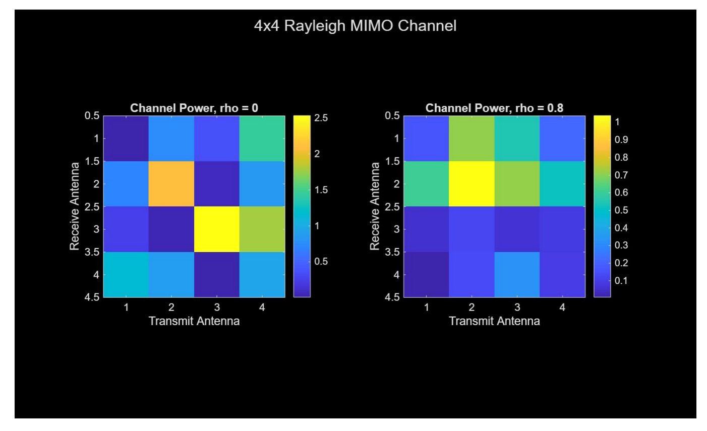
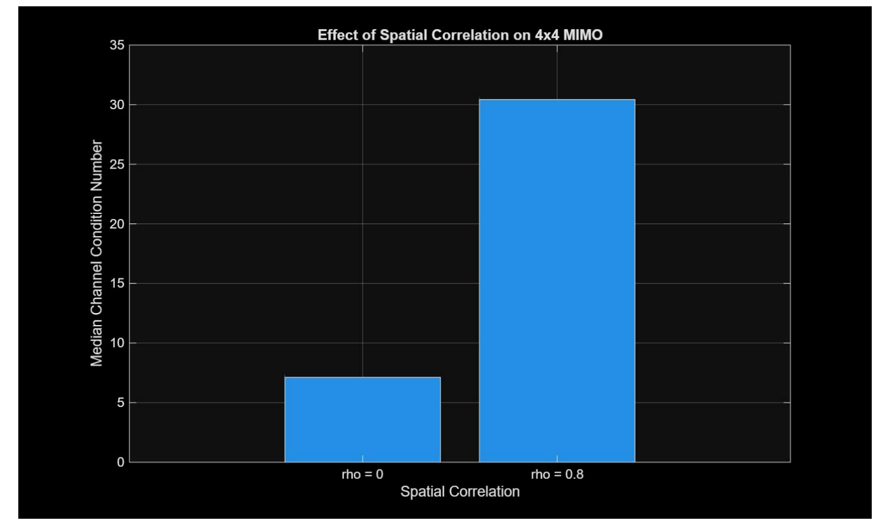
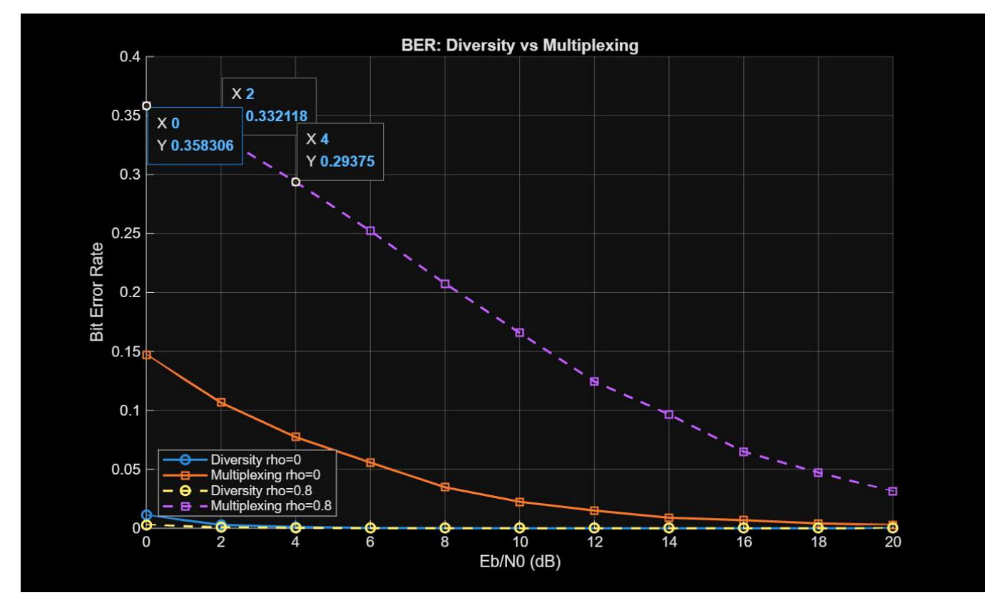
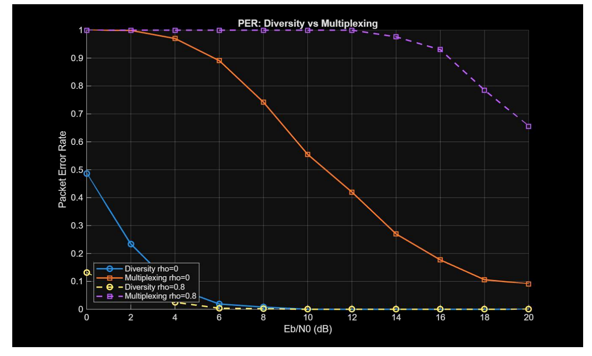
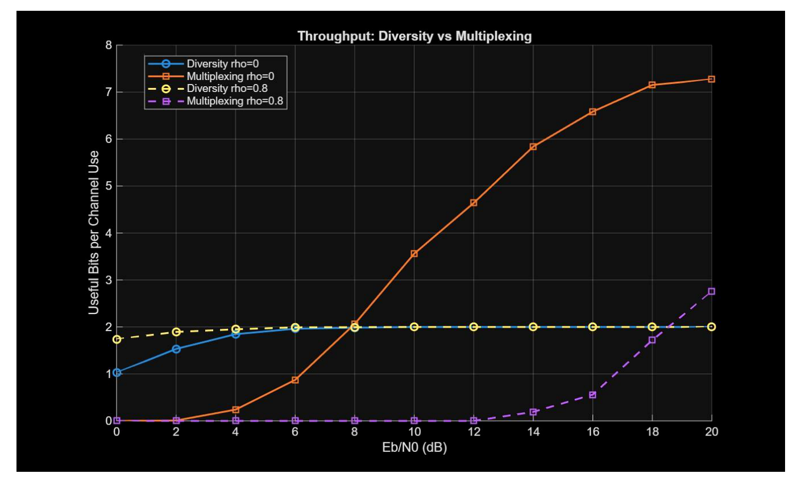

# 4x4 MIMO: Spatial Diversity vs. Spatial Multiplexing

**Wireless Communication & Computing (WCC) | Group 06, Question 15**  
**Repository type:** documentation and results showcase — **no source code included**

## Overview

This group assignment studies a 4x4 multiple-input multiple-output (MIMO) wireless link and compares two transmission strategies:

- **Spatial diversity:** transmits redundant information across antennas to improve reliability.
- **Spatial multiplexing:** transmits independent data streams in parallel to increase useful throughput when channel conditions support stream separation.

The channel study considers a Rayleigh-fading MIMO channel with additive white Gaussian noise (AWGN), and compares low spatial correlation (`rho = 0`) against a highly correlated case (`rho = 0.8`). The report discusses bit error rate (BER), packet error rate (PER), outage probability, useful throughput, and channel conditioning across an `Eb/N0` sweep.

## My contribution — Part B: Channel & Propagation Model

My assigned section covered the channel and propagation model. The contribution included the 4x4 Rayleigh MIMO channel setup, AWGN assumptions, spatial-correlation cases, interpretation of channel conditioning, and analysis of the simulation plots used to compare reliability and useful throughput.

See [`docs/part-b-channel-model.md`](docs/part-b-channel-model.md) for the focused summary.

## Selected results

### Rayleigh channel and spatial correlation

### Channel condition number

### BER versus Eb/N0

### PER versus Eb/N0

### Useful throughput versus Eb/N0

## Main takeaways from the submitted results

- The correlated channel (`rho = 0.8`) has a much higher median channel condition number in the plotted experiment, indicating that spatial correlation can make stream separation more difficult.
- The report's BER and PER plots show stronger reliability for the diversity strategy under the compared conditions, while the multiplexing strategy is more sensitive to channel correlation.
- In the plotted low-correlation case, spatial multiplexing attains higher useful throughput as `Eb/N0` rises. Its throughput advantage is reduced in the highly correlated channel.
- The engineering choice depends on the operating goal: favour diversity when reliability is critical; consider multiplexing when higher data rate is the priority and channel conditions allow effective separation.

These findings describe the supplied assignment's MATLAB simulation outputs, not a physical radio measurement or a general guarantee for every MIMO channel.

## Team and attribution

This is a **group assignment**, not a solo project. The report's contribution table assigns the sections as follows:

| Team member | Assigned section |
|---|---|
| Amritanshu Shukla | Part A — Transmitter design and implementation |
| **Aditya Shenoy B** | **Part B — Channel and propagation model** |
| Rajveer Singh Sidhu | Part C — Receiver design and implementation |
| Twinkle Tomar | Part D — Validation and engineering decision |

This repository highlights my assigned Part B contribution while acknowledging the wider group work.

## Repository contents

- `docs/part-b-channel-model.md` — text summary of the channel model and assigned contribution.
- `CONTRIBUTIONS.md` — group attribution and scope of this showcase.
- `results/figures/` — selected result plots extracted from the submitted assignment PDF.

**No `.m`, `.py`, `.ipynb`, executable, or other source-code files are included**, per request. Consequently, this repository presents the methodology and figures but is not independently runnable.

## Source context

Prepared from the submitted **G06_Q15** group-assignment report. Scanned cover pages, registration numbers, and unrelated team sections have not been republished in this showcase. The charts are included as representations of the reported results; please retain the group attribution if reusing them.
